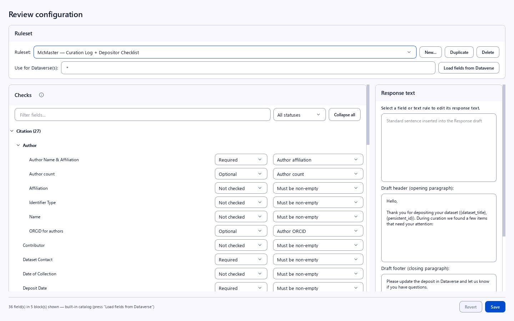

# Dataverse Docent

A desktop curation assistant for Alliance Dataverse instances. It pulls in datasets submitted for review, gates downloads behind curator approval, runs automated format checks on the files, checks metadata completeness against a configurable ruleset, and turns the findings into an exportable curation report and a ready-to-send response draft.



> **Windows-first.** The released build is **unsigned**: Windows SmartScreen warns on first run. Choose **More info → Run anyway** only after verifying the download with the published checksums.

## Contents

- [What it does](#what-it-does)
- [Install (Windows)](#install-windows)
- [Develop from source](#develop-from-source)
- [Configure](#configure)
- [Documentation](#documentation)
- [Contributing, support and security](#contributing-support-and-security)
- [Roadmap](#roadmap)
- [Context](#context)
- [License](#license)

## What it does

- **Curation queue** — searches and filters datasets from the configured Dataverse, with saved column layouts and per-dataset curation labels.
- **Approval-gated downloads** — shows file counts, sizes and access conditions first; the originals are staged locally and verified, with guestbook support and a cancellable progress view.
- **Automated checks** — 22 format checkers (CSV/XLSX/SPSS/SAS/Stata, JSON/XML, images, PDF, tabular and geospatial formats, archives, secrets, FASTQ and more) plus dataset-level inventory/access checks. Optional libraries degrade to warnings rather than failures.
- **Metadata completeness** — McMaster and Minimal profiles (and custom rulesets) with per-field required/optional rules, entry-correctness checks, and a per-dataset response draft.
- **Dataset detail** — version diffs, a file manifest, findings by file and by dataset, a request log, and JSON/Markdown report export.

## Install (Windows)

Get the latest release from [GitHub Releases](https://github.com/isaacpratt/dataverse-curation-app/releases):

| Asset | Use |
| --- | --- |
| `DataverseDocent-win-Setup.exe` | One-click per-user install (no admin prompt); Start menu and desktop shortcuts, uninstall via Apps & Features. |
| `DataverseDocent-win-Portable.zip` | Unzip and run; nothing is installed. |
| `SHA256SUMS.txt` | Verify the download before running it. |

Verify with PowerShell:

```powershell
Get-FileHash -Algorithm SHA256 .\DataverseDocent-win-Setup.exe
```

Compare the hash with the corresponding line in `SHA256SUMS.txt`. The build is unsigned until signing ships, so expect the SmartScreen click-through described above. Updates after the first install are delta-sized (usually a few MB).

## Develop from source

Prerequisites: **Python 3.11+** on Windows and [uv](https://docs.astral.sh/uv/). R is only needed to verify parity with the original scripts, not to run the app.

```powershell
uv sync                       # creates .venv with the locked dependencies (incl. dev tools)
uv run python main.py         # launch the desktop app; pick your Dataverse in Settings
uv run python main.py --gallery  # the component gallery: every kit component on one page
uv run pytest -q              # the full test suite
uv run poe typecheck          # mypy
uv run poe contracts          # import-linter: engine/core must not import the UI
python tools/probes/run_all.py  # offscreen UI and geometry probes
uv run poe build              # PyInstaller onedir build -> dist/DataverseDocent/
uv run poe pack               # Velopack installer + portable zip (needs .NET 10 SDK)
```

Headless check of a staged directory (no GUI, no Dataverse required):

```powershell
uv run python main.py --headless <staged_dir> --out report.json --format json --persistent-id doi:10.5072/FK2/EXAMPLE
```

Exit codes: `0` clean, `1` error-level findings, `2` usage/IO failure.

## Configure

Copy `config.example.json` to `config.json` and set your instance URL and API token, or open the app and use the Settings page (a Borealis demo preset is included). The token is read from your environment/credential store where possible and `config.json` is gitignored — never commit it. Rulesets live in `requirements_profiles.json` v2 beside the config.

## Documentation

The documentation is built with [Zensical](https://zensical.org/) from the
Markdown tree in `docs/` and published to GitHub Pages at
**https://isaacpratt.github.io/dataverse-curation-app/**. It follows
[Diátaxis](https://diataxis.fr) — one page, one purpose — with page structures
from [The Good Docs Project](https://thegooddocsproject.dev/). Documentation is
code: the Markdown is the only source of truth, reviewed in pull requests and
verified by automated checks.

- [Start here](https://isaacpratt.github.io/dataverse-curation-app/) — the site home and quadrant map.
- [Tutorial: your first review](https://isaacpratt.github.io/dataverse-curation-app/tutorials/first-review/) — learn by doing, end to end.
- [How-to guides](https://isaacpratt.github.io/dataverse-curation-app/how-to/install/) — install, configure, download, respond, run headless, add a check, build and release.
- [Reference](https://isaacpratt.github.io/dataverse-curation-app/reference/checks/) — checks, report contract, configuration, CLI, API, glossary.
- [Explanation](https://isaacpratt.github.io/dataverse-curation-app/explanation/architecture/) — architecture, discovery design, entry correctness, the R-to-Python port and UI conventions.
- [Troubleshooting](https://isaacpratt.github.io/dataverse-curation-app/troubleshooting/) — symptoms and fixes.
- [Documentation style guide](https://isaacpratt.github.io/dataverse-curation-app/style-guide/) — the rules every docs pull request follows.

Build or preview locally with `uv run poe docs` or `uv run poe docs-serve`;
run the full docs gate with `uv run poe docs-check`. Contributors: see
[CONTRIBUTING.md](CONTRIBUTING.md).

## Contributing, support and security

Start with [CONTRIBUTING.md](CONTRIBUTING.md) for setup, the quality gates and the documentation rules. The plan and open work live in [beads](https://github.com/gastownhall/beads): `bd ready` for what is unblocked, `bd list` for the full queue, `bd show <id>` for detail. Issues and support requests belong in the repository's issue tracker. **Security:** see [SECURITY.md](SECURITY.md) for the signing policy, checksum verification and how to report a vulnerability — please do not open a public issue for a security problem.

## Roadmap

Remaining work is tracked in beads (`bd ready` / `bd list`); completed decisions are recorded in `docs/internal/design-decisions.md` and `docs/adr/`.

## Context

The check engine ports the inspection scripts from **CUR_Res_CurationTools** (Curation Services Team, Digital Research Alliance of Canada). The Dataverse interaction and review-workflow patterns were informed by **rdm-review-dashboard**. Both are separate upstream projects; this repository does not vendor them.

## License

MIT — see [LICENSE](LICENSE). The engine checks are ported from the MIT-licensed `CUR_Res_CurationTools`; bundled Lucide icons are ISC-licensed. Released builds ship a generated `NOTICE` and a licence inventory of the locked dependency set (`uv run poe release-artefacts`).
