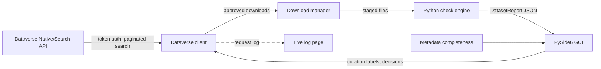

# Architecture

Single-process PySide6 desktop app: Dataverse API → approved downloads → Python check engine → metadata completeness → GUI + live request log.

## Component overview
Single process. Network + engine work runs on parented QThread workers; the GUI thread only renders. The engine never touches the network.



!!! note "Threading contract"
    Network and engine work runs on parented `QThread` workers; the GUI thread
    only renders. The engine never touches the network, and `curation/` and
    `engine/` never import `ui/` or PySide6 (enforced by import-linter).

## Components

| Component | Files | Responsibility |
| --- | --- | --- |
| Dataverse client | curation/client/ (was dataverse_client.py, then client/), curation/config.py | Token auth (X-Dataverse-key); discovery via total-driven paginated GET /api/search (per_page=1000, draft-aware dedup) plus pooled inventory enrichment (sizes, depositor, authoritative state); IN_REVIEW lock confirmation; metadata, file inventory (keeps UNF/tabular/original fields), bundle + original-format downloads, version compare/list, timestamps, notifications inbox, curation labels (bulk CSV → per-dataset → allowed set). |
| Download manager | curation/download_manager.py | Size quote (original size for tabular), approval gate, skip-if-fully-staged, streaming zip with progress, original-format fetch then .tab removal (originals-only), zip-slip guard, verify() → (ok, problems, warnings) (originals by size; non-tabular mismatches are problems), staging + metadata.json/file-manifest.json. |
| Check engine | engine/ | 22 per-format checks (engine/checks/*_check.py, base.py:Check/CheckResult), registry-driven dispatch (dispatcher.py), DatasetReport (report.py), list_planned_checks (runner.py), badge taxonomy (status.py), scan caps (constants.py), Markdown view (report_md.py). Heavy libs lazy; secrets (hush-scan) and structured PII (piigex + CA pack) ship in both builds. |
| Metadata completeness | curation/metadata_check.py + curation/review_rules.py | Rule-driven completeness from versioned rulesets (mcmaster-default derived from the McMaster Curation Log / Depositor Checklist — source PDFs retired 2026-10-07, rules live in code — and minimal), per-author ORCID + author count + license/terms handlers, README/text-search content rules, requirements_profiles.json v2, per-Dataverse assignment. |
| Local state | curation/storage.py (+ curation/dashboard_cache.py) | SQLite state.db (datasets/files/check_results/curation_actions) + JSON caches: dataset_sizes.json, curation_labels.json, dashboard_cache.json (instant paint + change-only refresh), table_layout.json (restore_table_state → bool locks auto-fit when a saved view applied). |
| App log | curation/applog.py | In-memory ring buffer (AppLog, 2000 lines), log_response(method, URL, status, ms, summary) with token redaction, surfaced in the Log stack page. |
| GUI | ui/ (21 modules + the ui/dataset/ package) | Dashboard (12 columns, filters, cache-first paint + diff_dashboard_datasets, painted-row window), dataset detail (main + sticky sidebar, assessment pushes label via set_curation_label) — one facade over ten section modules, sharing a typed contract, settings / review-config / about / log stack pages, workers (Crawl/Download/Check/Metadata/MetadataBlocks), selectable dialogs, manifest tree (checks_tree.py), progress ring (ring.py + pure progress.py), shared kit (widgets.py: AppTable/AppTree, the builders, the component gallery) + the layout controller (table_layout.py) + the theme (theme.py: palette, role layer, contrast contract, visible QHeaderView dividers) — see the UI layering contract below. |

## UI layering contract

Every pixel the app draws comes from one place, and there are exactly three layers. A view composes them; it never paints.

1Paletteui/theme.py — what a colour is: PRIMARY, SURFACE_CONTAINER_LOW, ERROR. Raw values, no meaning attached.
→
2RoleWhat a colour is for: ACCENT_PRIMARY, SURFACE_CARD, TEXT_DANGER. A mapping over the palette, one table per theme, so a theme swap is a table edit.
→
3ComponentThe kit (ui/widgets.py): make_action_button(), make_badge(), make_list(). What the user touches.
Only ui/theme.py and ui/widgets.py may name a palette entry. A view names a role (SURFACE_CARD), the kit builds the component, and the theme owns the rules. The rules are checked, not reviewed: ui/tests/test_theme_conformance.py fails the build when a view paints for itself, names a raw colour, builds a raw input widget, or builds a button sheet by hand.

### The role layer

The role names are stable; what a name resolves to is not. ui/theme.py holds one table per theme — LIGHT_ROLE_TABLE (what the app paints today) and DARK_ROLE_TABLE — over the same 94 role names, plus a resolver (theme.role(name, theme=None)) and a switch (theme.set_active_theme(name)). The palette stays one palette (PRIMARY is still #004ccd); the table decides which colour each role wears in which theme. ui/tests/test_theme_role_tables.py holds the contract: the light mappings did not move, both tables declare the same roles, and the dark table clears the same contrast floors on its own surfaces. Dark mode itself is not shipped yet — see the dark-mode steps in the development docs.

| Group | Roles | What it is for |
| --- | --- | --- |
| Text | TEXT_PRIMARY, TEXT_MUTED, TEXT_SUBTLE, TEXT_ON_ACCENT, TEXT_ON_TINT, TEXT_ON_SECONDARY, TEXT_ON_ERROR, TEXT_DANGER, TEXT_SUCCESS, TEXT_WARNING, TEXT_AMBER, TEXT_DISABLED | Copy on a known surface. Each role names the surface it is meant to sit on, which is what makes the pairing checkable. |
| Surface | SURFACE_PAGE, SURFACE_CARD, SURFACE_TINT, SURFACE_SUBTLE, SURFACE_ROW, SURFACE_HEADER, SURFACE_RAISED, SURFACE_ALT, SURFACE_DISABLED | The plane a component sits on: the page behind everything, a card, a header band, a disabled control's face. |
| Border | BORDER_SUBTLE, BORDER_STRONG, BORDER_DISABLED | An edge that separates (subtle), an edge that carries meaning (strong), an edge of a control that cannot be used. |
| Accent | ACCENT_PRIMARY, ACCENT_PRIMARY_HOVER, ACCENT_PRIMARY_PRESSED, ACCENT_PRIMARY_DISABLED, ACCENT_PRIMARY_DEEP, ACCENT_TINT, ACCENT_FOCUS_TINT, ACCENT_SECONDARY, ACCENT_TERTIARY | The brand fill and its states. A component asks for “the accent”, not for “blue”. |
| State | STATE_ERROR_BG, STATE_ERROR_SURFACE, STATE_ERROR_BORDER, STATE_ERROR_TEXT, STATE_ERROR_GRAPHIC, STATE_SUCCESS_TEXT, STATE_SUCCESS_GRAPHIC, STATE_WARNING_TEXT, STATE_WARNING_GRAPHIC | How a failure, a pass and a caution look. Text and graphic roles are separate because their contrast floors differ. |

### The contrast contract

The pairing rules the app actually paints are data, not folklore: theme.CONTRAST_PAIRS and theme.BADGE_CONTRAST_PAIRS list every foreground/background pair with the ratio it must clear. ui/tests/test_contrast.py reads that table, so a palette change that breaks legibility fails the build instead of shipping.

| Kind | Floor | Why |
| --- | --- | --- |
| text | 4.5:1 | WCAG 2.1 AA for normal-size text. |
| graphic | 3:1 | WCAG 2.1 AA for icons and other non-text marks. |
| disabled | 3:1 | Disabled controls are exempt from WCAG 1.4.3. The app holds them to 3:1 anyway, so a control that cannot be used still reads as present. |

The contract caught three real defects. The disabled primary button painted white on a pale blue face (2.35:1 — unreadable); it now wears the primary text role on the muted fill (7.29:1). The muted text role was 2.54:1 on a card; it is now 3.70:1. The green badge fill was 3.30:1 against white and is now 5.02:1.

### One button system

theme.button_qss(kind) generates the app-level object-name rule; theme.button_qss(kind, selector="QPushButton") generates the widget-level copy. Both come from the same function, so they cannot drift — and they had: the app-level sheet had no disabled state at all while the inline copy had one that was unreadable. The kit's make_action_button() carries the scoped copy, because a widget-level stylesheet replaces the application sheet for that subtree and a button face inside a styled panel does not paint otherwise.

```
from ui.widgets import make_action_button

save = make_action_button("Save", kind="primary", tip="Save the draft")
```

ui/tests/test_controls_and_states.py and ui/tests/test_gallery_contract.py check the two button sheets agree property by property, that the app sheet carries one rule per kind, that the disabled primary label still clears 3:1, and that the gallery exhibits every kit component.

| Kind | Face | Used for |
| --- | --- | --- |
| primary | brand fill, label on the fill | The one committing action on a surface. |
| secondary | outline on the card | Every other action. |
| ghost | no fill until hover | Low-emphasis actions beside a stronger one. |
| chip | rounded, tinted | Filters and toggles. |
| cell | compact outline (0 8px padding) | A table action cell. The standard action padding (7px 14px) made two buttons need 294px against a 240px column, clipping both; the cell face is the same system at cell width. |
| link | left-aligned brand text | A row that navigates to a section of the page. |
| nav-active / nav | bar item, filled when active | The navigation bar. |

A label wears a token rather than a painted style: the object name carries the token (HeadlineLG, BodyMD, CaptionSM, MonoSM, HintSM, AccentSM, SuccessSM, WarningSM, DangerSM, LabelStrongSM, StateMD, LabelMD), and the theme owns the rule for each. A widget whose text changes at runtime (a connection verdict, a status pill) changes its object name and re-polishes, so it lands on the token that matches its state.

### The guards

| Guard | Rule | Test |
| --- | --- | --- |
| No inline stylesheet in a view | A view asks the theme for a rule or the kit for a component. The one escape is an explicit # theme-allow: marker on the line. | test_no_view_writes_its_own_stylesheet |
| No raw palette name in a view | Only the theme and the kit name palette entries. The palette set is derived from the theme's own source, so a new palette entry is covered the moment it is written. | test_no_view_names_a_raw_palette_entry |
| No raw input widget in a view | The standard text inputs, lists, check boxes, progress bars, combos and buttons come from the kit. | test_no_view_builds_a_raw_input_widget |
| No button or badge sheet in a view | make_action_button() and make_badge() own those faces. | test_no_view_builds_a_button_or_badge_sheet_itself |

They parse the source with ast, so they are cheap, exact and need no window. The gallery (ui/gallery.py) is a view too and obeys the same rules: it is the kit on one page, built only through the kit.

## Table component contract

Every table and tree in the app is built from ui/widgets.py and persists its column layout through ui/table_layout.py. The rules below are enforced by ui/tests/test_table_layout.py, ui/tests/test_table_geometry.py and ui/tests/test_type_scale.py, and checked by the probes in tools/probes/.

### The parts

| Part | File | Contract |
| --- | --- | --- |
| AppTable | ui/widgets.py | QTableWidget with a themed header, hidden vertical header, row selection, Ctrl+C copy, no grid and NoFrame (the 1px frame would inset a flush table by a pixel inside its card). Emits columns_fitted (a content fit finished) and user_layout_changed (the user dragged an edge or moved a column). |
| AppTree | ui/widgets.py | The tree sibling of AppTable: a QTreeView (the manifest is model-driven), same header chrome, transparent scrollbar lanes, movable and resizable columns, and the same user_layout_changed signal. |
| AppTreeWidget | ui/widgets.py | The QTreeWidget sibling, for the trees that host their own cell widgets (the metadata field rules and their per-field combo). Same chrome and the same user_layout_changed signal. |
| TableLayout | ui/table_layout.py | One controller per header. It owns the construction snapshot, the restore, the persistence and the reset, so no view repeats that wiring. |
| SortArrowHeaderView | ui/widgets.py | QHeaderView that draws its own sort arrow as a child-label overlay (Lucide chevron, right-aligned in the sorted section), suppressing the style's native CE_HeaderSortIndicator that paints a stray glyph at section top-centre under the header QSS on this Qt build. |
| make_reset_columns_button() | ui/widgets.py | The one reset affordance: a 28px ghost button with the rotate-ccw icon, an accessible name and a tooltip. |
| header_section_qss() / scrollbar_lane_qss() | ui/theme.py | The shared header and scrollbar rules. A widget-level stylesheet replaces the app-level rules for that subtree, so the local sheets repeat them from these mixins instead of by hand. |

### Only user gestures are persisted

A programmatic resize — a content fit, a viewport refit, a state restore — must never overwrite the layout the user chose. It runs inside layout.suppressed(), and the controller ignores the signals it emits. Four copies of “wire sectionResized straight to a save” is how the file manifest lost the user's widths on every refresh.
```
self._layout = TableLayout(workspace, "dataset_files", tree.header(), view=tree)
self._layout.restore()          # the saved layout wins over the content fit

with self._layout.suppressed(): # the app's own change: not persisted
    tree.fit_columns_to_contents(floors={0: 260})

self._layout.reset()            # clears the saved entry, restores the snapshot
```

The controller binds to view.user_layout_changed when the view has it (AppTable, AppTree, AppTreeWidget) and to the header's own signals otherwise; the suppressed() scope tells the two apart. It stores itself on the header via header.setProperty("tableLayout", self), so a view that forgets to keep a reference does not silently lose the persistence.

The kit's views report a gesture only when the user could have caused it: a section the layout owns (a Stretch or Fixed section, or the last section of a stretching header) is sized by the layout, and Qt reports those resizes the same way it reports a drag. Without that check every window resize would rewrite the saved layout.

### Layout schema

workspace/table_layout.json holds one entry per table, keyed by a stable name (dashboard_queue, dataset_files, review_fields, extensions). Each entry carries "v": the schema version (storage.TABLE_LAYOUT_VERSION). storage.table_layout_entry_valid(entry, column_count) accepts a legacy entry (no "v") whose width list matches the column count and rejects an entry written for a different table shape — a stale layout is ignored rather than squeezing the wrong columns. A newer version than the app understands is ignored too, never half-applied.

### Geometry

- The queue has no horizontal scrollbar, so the visible column widths add up to the viewport width exactly. One pixel over is still a clipped column, so the fit shaves the difference off the widest sections.
- The queue's column bar is the table's own header (native mode). An older split header (the table's header hidden, a second display header painted above it) needed a two-way size and order sync, the source of the clipped columns and the off-centre last label; it was removed in favour of the native header.
- A table or tree flush inside a card paints its own corners: Qt never clips children to a parent's border-radius, so the end caps stay square and the scrollbar lanes stay transparent. A filled lane paints the page colour over the card's rounded bottom-right corner, and the card border ends in a white notch.

### Type scale

Every text size comes from ui/theme.py: FONT_MICRO 11, FONT_CAPTION 11, FONT_SMALL 12, FONT_BODY 13, FONT_SECTION 15, FONT_TITLE 16, FONT_HEADLINE 22. A label wears a token (its object name is the token: HeadlineLG, CardTitle, BodyMD, CaptionSM, LabelMD, DisplayLG, StateMD); a widget that needs its own stylesheet takes the size from the constants. ui/tests/test_type_scale.py fails if a module outside the theme writes a raw font-size: Npx.

## Threading model

The GUI thread never blocks. Workers are parented to their views with deleteLater chained on completion; a discarded detail view's live workers are adopted by the main window — a live QThread is never destroyed. One check run at a time per dataset; results persist as DatasetReport so a crash loses nothing. The Log page polls applog.get_app_log().lines() on an 800 ms QTimer (Live toggle, gated to page visibility, search debounced at 200 ms).

Heavy optional dependencies (pyreadstat, netCDF4, h5py, tifffile, Pillow, pypdf, lxml, openpyxl) are imported lazily inside each check; a missing lib yields CheckResult(level="warning", passed=True, message="Missing: pip install … — check not executed"), never an error. JPG/PNG/GIF/BMP/WEBP add a stdlib header fallback when Pillow is absent.

## Data flow for one dataset

1Discoverlist_draft_datasets() pages Search at per_page=1000, driven by the server's total_count; pooled enrichment adds live sizes/depositor; CrawlWorker confirms locks + labels; cache-first paint, background diff reports N new, M updated, K removed.
→
2InspectDetail auto-loads (QTimer.singleShot(100), MetadataWorker): metadata, inventory, curation, diff, versions, timestamps, review submission.
→
3DownloadDownload All quotes (original size for tabular), skips fully-staged, streams bundle, fetches originals, drops .tab, verifies (ok, problems, warnings); both stream loops poll an is_cancelled flag → DownloadCancelled → detail Cancel.
→
4CheckRun checks (CheckWorker → run_report): dispatch per file + dataset-level extensions; exports to workspace/downloads//reports/.
→
5CurateMain column (completeness, manifest, auto-checks, version log) + sidebar (Preview head, timeline → assessment lives on the Response page and pushes the curation label). The workflow rail (mechanical or CURATE(D)) is the single jump-navigation; the sidebar is chrome. Header link is version-aware (…&version=DRAFT).

## Local storage

| Path | Contents |
| --- | --- |
| workspace/state.db | SQLite: datasets, files, check_results, curation_actions (append-only timeline), finding_dispositions (per-finding curator decisions, keyed by a stable sha1 of check id + path + message so they re-attach across re-runs), sensitivity_reviews, follow_ups (open "waiting on the depositor" states, dv-5eg) |
| workspace/downloads/<pid>/ | Staged files (preserves directoryLabel), metadata.json, file-manifest.json, reports/<id>_report.{json,md}, response_draft.md |
| workspace/dataset_sizes.json | Summed inventory sizes (dashboard Size column) |
| workspace/curation_labels.json | Per-instance label sets, keyed by base URL (probe-pure) |
| workspace/dashboard_cache.json | Last crawl per instance+collection (instant paint + change-only refresh) |
| workspace/table_layout.json | Column widths/sort/hidden/order for dashboard, dataset tables, extensions, review-fields tree — versioned entries (storage.TABLE_LAYOUT_VERSION), written only by user gestures (see Table component contract below) |
| config.json | URL, token, collection alias, workspace path (--config/--dataverse overrides). Installed builds keep it in %APPDATA%\Dataverse Docent\ where an update or uninstall cannot reach it; portable builds keep it beside the exe; dev runs use the working directory (config.resolve_user_file is that one policy, with a one-time copy from the old beside-the-exe location). An install and the portable zip share the current/ + Update.exe layout, so the portable package is recognised by the .portable marker at its root before the folder shape counts as an install |
| requirements_profiles.json | Versioned review rulesets (field + text-search rules, per-rule response templates, editable on the Review configuration page); same location policy as config.json |

## Report contract

The engine and GUI communicate through DatasetReport JSON, defined in Report contract and implemented in engine/report.py. The GUI renders this structure directly, without knowing individual checks. Headless mode (python main.py --headless --out report.json) exercises the same contract without the GUI.

## Extensibility

Adding a format check is a new module in engine/checks/ implementing engine/checks/base.py:Check (check_id in format..*), registered in engine/checks/__init__.py:registry. See Development. The Auto-Checks card and list_planned_checks pick it up automatically; missing libs are surfaced as “Missing: pip install …”. Check semantics (Checks reference) are part of the contract.

## Packaging and deployment

| Artefact | How | Covers |
| --- | --- | --- |
| dist/DataverseDocent/DataverseDocent.exe (onedir) | --windowed --onedir --name DataverseDocent, safe trims only (tkinter, turtle, PIL.ImageTk, PIL.SpiderImagePlugin, PIL._avif, unused Qt modules); every format library stays in (Pillow, pypdf, lxml, openpyxl, tifffile, chardet, pyreadstat, netCDF4, h5py); --icon ui/assets/docent-mark.ico; --collect-all piigex; --add-data "ui/assets;ui/assets"; flags in tools/build/build_app.py, which copies config.example.json in | The one artefact and the input to poe pack: all 22 checks work offline with no sibling folder or second download, and the window still shows in ~2.1 s (pid-measured); 229 MB, ~55 s to build |
| dist/releases/DataverseDocent-win-Setup.exe (+ DataverseDocent-win-Portable.zip, DataverseDocent-0.1.0-full.nupkg, releases.win.json) | uv run poe pack → tools/build/pack_app.py → vpk pack (Velopack 1.2.161; the .NET 10 SDK and dotnet tool install -g vpk are build-time only). Fixed identity in tools/build/check_pack.py: --packId DataverseDocent, --packTitle "Dataverse Docent", --mainExe DataverseDocent.exe, --channel win, --runtime win-x64, and --packVersion from engine.__version__; the same module then checks the result (poe check-pack re-runs just that check) | The shipped install: per-user, no admin prompt, Start menu + desktop shortcuts, an Apps & Features entry and an uninstaller under %LocalAppData%\DataverseDocent (which is why config and rulesets live in %APPDATA%). 110 MB Setup.exe, 102 MB portable zip, 102 MB nupkg, ~15 s to pack. Updates are deltas: 209 KB for a one-file change once the previous release is in the output folder. Nothing is published from here — vpk upload belongs to the tag-driven workflow |

poe tasks in pyproject.toml (no shell portability caveats): build (the one artefact, dist/DataverseDocent, plus config.example.json — the loop you run while developing) · pack (Velopack release directory, verified) · check-pack (verify an existing dist/releases) · smoke · check (lint + typecheck + tests). Qt/UI imports are lazy in main.py with PyInstaller hidden-imports covering pyi_rth_pyside6 (the flag list moved out of the old .spec/Makefile pair into tools/build/build_app.py). A committed uv.lock pins the resolution for every build; uv lock --check runs in CI and in the pre-commit gate. Build cost: PyInstaller re-analyses the import graph on every run (about 55 s, some 23 s of it in the PySide6 hooks), so --clean buys nothing and is gone, and there is no second variant to build — the lite folder that used to double the wall time is gone with it, because Velopack's portable zip is the small download it existed to offer. One flag list, one artefact, smoke-tested with poe smoke (override DOCENT_SMOKE_EXE).

Every format library ships in the one build, so the sibling-sys.path lookup is gone (main._sibling_libs_path() and the "use the full build" advice went with the second variant; a frozen run that is missing a library now reports a warning and a reinstall, because onedir _internal could never supply pure-Python modules anyway). Missing optional libs report “Missing …” rather than failing. Optional tools (tesseract OCR, external exiftool) degrade gracefully — no R dependency at runtime; R was only needed during the port for parity verification. Network: the client (curation/client/client.py) retries 3× on ConnectionError/ChunkedEncodingError/ConnectionResetError (WinError 10054) with backoff + 429/503 Retry-After (≤30 s); dialogs are selectable (ui/dialogs.py) for copying tracebacks.

## Decision log (condensed)

| Date | Decision |
| --- | --- |
| 2026-08-17 | PySide6 single-process desktop; API-token auth; Python port over portable R (~400 MB) |
| 2026-08-21/25 | dvmeta CLI draft crawl + IN_REVIEW locks; paginated Search fallback (start, dedup, subtree); streaming download; 10054 retry; metadata completeness as first-class feature (McMaster profile); lite packaging with lazy imports |
| 2026-10-29 | dvmeta removed (the crawler's 0.2.0 restructure broke the CLI contract, so the branch was dead code): discovery is now total-driven Search at per_page=1000 + in-process pooled inventory enrichment, which every user — including frozen exe users — gets. Progress ring with catch-up/backoff; painted-row window for very large collections |
| 2026-09-08/15 | Detail main + sticky sidebar; settings/about as stack panes; log strip → Log stack page; problems-vs-warnings verify; originals-only tabular; skip-if-staged; QThread adoption; dashboard cache-first paint; MIT license |
| 2026-09-11/23 | ui/widgets.py kit as single source of truth (RinUI QML rejected); audit batches: compound dispatch, missing-lib guards, atomic staging, Timeout/429/503 retries, caps, taxonomy; per-author ORCID/count + license/terms rules; caption-button hit codes |
| 2026-09-25 → 10-02 | Theme tokens single-sourced (test_theme_tokens.py enforces); keyboard parity + plain-language errors; caption HTCLIENT fix; colour-not-outline focus; named loading states; guarded decision combo; Copy diagnostics (never the token); title-bar WM_NCCALCSIZE healing |
| 2026-10-06 | Dataverse Docent rebrand (app/About/README/docs; dashboard bottom status bar; docent.png app art); critique re-run 28→26/40 with probe suites promoted to permanent tests + CI workflow; mid-download Cancel; log inline severity legend |
| 2026-10-07 | Status unified into the one dashboard pill (scope + message live inside StatusPill, row ends before the mark); About mark at native 64×64; dashboard + taskbar/window icon → 16x16.png (theme.mark_icon_path()); both PNGs moved to ui/assets/ via theme.asset_path() |
| 2026-11-04 | Table contract: one layout controller per header (ui/table_layout.py) that persists user gestures only (programmatic fits run inside suppressed()); the queue's split header demoted to an opt-in fallback (SPLIT_QUEUE_HEADER) so the table's own header is the column bar; one reset-columns affordance; shared header/scrollbar QSS mixins; one type scale (theme tokens + FONT_* constants); versioned table_layout.json entries; probes in tools/probes/ promoted to pytest contracts |
| 2026-10-07 | Lite artefact onefile → onedir (window ~2.1 s vs 21–24 s re-extraction) and exe/Explorer/taskbar icon unified on docent-mark.ico (--icon in build-lite.ps1 and the Makefile, which previously shipped no icon); safe trims tkinter/turtle/PIL.ImageTk/PIL.SpiderImagePlugin/PIL._avif; parent-dir fallbacks for sibling libs, config.json and requirements_profiles.json (fresh files land above the build folder PyInstaller wipes) |
| 2026-11-04 | Settings unsaved-changes guard: baseline-snapshot dirty tracking (edit-then-restore clears itself), a shared PaneFooter (Save/Revert/status) reused by Settings and Review configuration, persist() split from the close-and-refresh saved signal via configurationChanged, and one _can_leave_settings() guard on every exit including window close (Save / Discard / Cancel, Cancel default). Detail workflow rail: a six-step rail (Metadata → Changes → Download → Checks → Export → Respond) replaces the Review/Response tab row; pure Qt-free derivation in ui/workflow.py, navigation-only steps that never start a download or export |
| 2026-11-06 | Beads as planner: issues live in the local Dolt DB (.beads/dolt, prefix dv); bd ready is the queue, bd show <id> the detail. Docs/proposals mirror the beads; beads win on disagreement. Sync via bd dolt push/pull (refs/dolt/data), not .beads/issues.jsonl |
| 2026-11-12 | Seven reported UI fixes (beads dv-dmv/dv-dvu/dv-ap7/dv-wp1/dv-0kq/dv-coj/dv-1k4): metadata table — every column Interactive so the Value|Status boundary drags, with Value re-filling the leftover width through _fit_meta_value_column() (programmatic widths stay inside the layout's suppressed() scope so user drags persist); top-bar dataset chips — _ElidedChipButton.sizeHint() measures the FULL title (no more ratchet to "Selecti…"), the 240px cap is gone, and the close half centres its Lucide x icon (fallback glyph ×); log severity legend — ordinary BodySM text in highlighter colours (no badge face/uppercase/weight/tracking), via kit make_text_label(); header band — no vertical border-right between sections anywhere (review-config, dataset and manifest tables); selection — one theme selection_qss() face (SECONDARY_CONTAINER full row, also on !active), one SelectionDelegate that drops Qt's per-item dotted focus rectangle, QTreeView ::item descendant-selector bug fixed (the rules were dead, so views fell back to the native blue highlight), and branch chevrons painted by ui.widgets._BranchPainting because the Windows 11 style ignores image: none and painted a blue chevron chip on the selected row — the 2px "stripe"; metric cards — tooltips removed, #MetricCard:hover signals the filter, card children mouse-transparent so the whole chip (not just the icon) is the click target. Guarded by test_metadata_columns.py, test_dataset_chip.py, test_selection_indicator.py and test_metric_card_filter.py |
| 2026-11-16 | Install and update pipeline (bead dv-4t6): Velopack (MIT) replaces the Inno/WiX plan - a per-user one-click Setup.exe, deltas, shortcuts and an Apps & Features entry, with vpk needing .NET 8 only at build time; the feed is the repo's own public releases (GithubSource, unauthenticated, so the app checks at most once a day against the 60 req/h limit). One full installer, not a thin core plus downloadable extras: the heavy libs cost 27.8 MB compressed (pyreadstat 5.6 MB unpacked, h5py 8.0, NetCDF4 57.8 - the last one is 80% of it; scipy is in the exclude flags but is not a dependency at all), while an extras tier would need its own per-core-version ABI-pinned bundles outside the package because Velopack replaces current/ and deletes the install folder on uninstall. User-editable files therefore moved to %APPDATA%\Dataverse Docent\ (config.json and requirements_profiles.json: installed builds per-user, portable beside the exe, dev in the CWD) with a one-time copy from the old location. The version now has one literal (engine.__version__, read by the wheel metadata) and tools/build/check_version.py refuses a tag that disagrees with it before anything is built. v0.2.0 ships unsigned with a documented SmartScreen click-through; SignPath Foundation signing follows (dv-4t6.6, gated on dv-hcg.39). macOS is deferred: an unnotarised .app is blocked by Gatekeeper and needs the paid Apple Developer Program - Homebrew 5.0 deprecated --no-quarantine and the official cask tap now expects Gatekeeper-passing apps, so brew is not a workaround. poe pack (tools/build/pack_app.py) turns dist/DataverseDocent into a Velopack release directory, and tools/build/check_pack.py - run by the task and by CI - refuses a Setup.exe, nupkg or feed whose id, version, main exe, architecture or channel disagrees with the pinned identity, because those name install locations no uninstaller can repair. dv-4t6.5 wires Velopack's runtime for real: the daily tick in main.py runs after the window is painted, the About pane owns the whole dance (status, last check, one primary action, progress while downloading, restart-and-install when ready), and engine/feed.py single-sources the repo URL shared by the frozen-layout policy and the check itself |
| 2026-11-16 | One name and one build: Dataverse Docent (DataverseDocent for identifiers). The app, its PyInstaller artefact (dist/DataverseDocent/DataverseDocent.exe), the installer's --mainExe, the Start menu entry, the Apps & Features row and the distribution name (dataverse-docent) now say the product name instead of curation-app-full/curation-app-lite; the repository folder keeps its name, and "curation" stays a domain word (the curation report, curation labels, the Review steps). The two-variant build went with the rename: Velopack's portable zip already is the smaller download the lite folder existed to provide, so poe build makes one folder and build-all/build-lite/build-full, copy_example_config, main._sibling_libs_path() and their tests are removed (the build script copies config.example.json itself). A frozen build that lacks a library now names a reinstall rather than a second download |
| 2026-11-13 | Metadata check restyled to the Auto-Checks card (bead dv-h70): the five-column Check | Level | Block | Value | Status tree is gone; every rule renders one row in the Auto-Checks idiom — icon reflecting the outcome (complete / incomplete / not checked), bold name (the rule's label), a one-line verdict sentence (the depositor's value), right-aligned badge (Complete / Incomplete / Not checked) and a thin bar on required rules — since removed by bead dv-onk (2026-11-17): the bar read as an error; no coloured bar is painted anymore, the required/optional wording rides the row tooltip. Rules are grouped under collapsible block headings (Citation first, then alphabetical by display name) with a counts subtitle (x of y complete), and compound fields (authors, contacts, publications, descriptions) expand into an inline drawer — one block per entry, each subfield as a Label: value caption line (Name: Ada Lovelace), headline taken from the author name regardless of API key order. New Not checked filter exposes rules the ruleset marks unchecked via evaluate_ruleset(..., include_unchecked=True) — display-only status="skipped" rows, hidden by default, no verdict, no disposition controls; the Response pane never sees them. The filter combo now carries All / Complete / Incomplete / Not checked; the reset-columns button is gone (no columns). Dispositions keep parity with Auto-Checks: incomplete rows carry the inline combo + Note button and right-click → the same dv-32x menu. Test counts: pytest is 779 (372 engine + 407 UI) |
| 2026-11-13 | Human-readable check names (beads dv-r0z/dv-dcd): one TITLES registry in engine/checks/guidance.py names every check (CSV Openable, Zero-Byte Files, …) next to the dv-lfn guidance, enforced complete by the engine conformance test (now scanning engine/runner.py, which synthesizes inventory.unchecked_types itself). The File Manifest's check rows lead with the name — status stays on the name-cell icon — and the Scan column is the verdict sentence (engine's filename:  prefix stripped, no PASS/WARN badge, filename never repeated); dv-32x's disposition label still joins the Scan text. Auto-Checks rows name checks the same way; planned checks read Applies to: .sav with a Will run badge, and a missing optional library is spelled out in-row instead of only in a tooltip. Tooltips are prose (title, state, sentence, important details, why/how-to-fix) — never raw ids or JSON. Entry-correctness rules (bead dv-5id): new looks_correct rule handler; params in rule JSON — min_length (concatenated for plain fields, per-entry for dotted compound paths), regex/regex_mode, blocklist, controlled_vocabulary (inline list), date, date_order (start ≤ end inside compound date ranges), url, and not_common_placeholders/not_all_caps built-ins. Every failure carries a bracketed reason (e.g. [too short: 12 of 50 characters]), empty value → incomplete, no effective checks configured → fail closed ([no silent passes), and an invalid regex fails the rule loudly. Verdicts flow through evaluate_ruleset like every other rule (field:block.field:looks_correct), so the Metadata check table and Response draft need no new code paths. Review configuration gains a Check picker on field rules plus an Entry checks panel (only while the new check is picked; switching seeds not_common_placeholders); params round-trip as plain rule JSON. Also fixed a latent _rule_sel_key bug — the field name was missing from the key, so lookups only worked via the selected-combo fallback and same-block/handler rules collided. Guarding context: a post-implementation review pass (two independent reviewers) hardened the fail-closed semantics further — a dotted rule carrying only date_order fails closed, sloppy params (an unparseable min_length or unknown regex_mode) fail the rule with a bracketed rule error instead of being clamped, a crashing handler emits an incomplete [rule error] row instead of vanishing from the results, synthesized unchecked rows dedupe against the checked rule for the same id, status="skipped" rows never reach the verdict or the Response draft, and a note typed without a disposition defaults to acknowledged (storage issues a DELETE for an empty token, which silently discarded the note). Guarded by curation/tests/test_looks_correct.py, ui/tests/test_review_config_looks_correct.py and ui/tests/test_check_titles.py |
| 2026-11-13 | Expected API refusals are not bugs (beads dv-p4v/dv-8tb/dv-su2): dataverse_client._refusal() classifies every 4xx by (path, status, body) into a machine code and a one-line reason — draft_not_readable (401/403 on a draft: Dataverse grants draft access only inside the dataset's curation scope), no_published_version (404 on :latest/:latest-published: deaccessioned versions are excluded by default), not_under_curation (403 on curationStatus), no_draft_version, no_versions_to_compare. The Log keeps the raw call and response verbatim and appends the reason: the line is tagged EXPECTED (muted tone in ui/log_panel.py, third legend entry) instead of ERROR; anything unclassified (500, 400, a wrong path) stays an ERROR. Reads that cannot exist are not sent: the Native API's dataset read answers with the version the account may see (the draft for a dataset under curation, the published version otherwise, no version for a deaccessioned one), so the crawl reads each dataset once with no version probe; only a row the Search payload marks as under curation is additionally probed at :draft (a :draft probe on a published dataset is refused every time, and :latest/:latest-published are 404 for a deaccessioned dataset — neither is ever sent); the queue row travels with the open request, so the detail view skips the curation status, the label history and the version comparison for a dataset with no draft. A refusal on one dataset no longer aborts the enrichment batch — it is marked on that row (access: state, reason code, server message) and the batch continues (the search call already proved the token works). The queue says what could not be read: a new Access column shows Draft not readable / Not readable / No published version / Curation state hidden (empty when everything read), with the reason and the server's own words in the cell tooltip; the detail view's file-list notice says the draft is not readable for this account instead of a generic failure. The search reconciliation now explains the gap: the index counts documents, so a dataset listed twice (published + draft) was merged — Search collected 26 of 29 is information, not an error. Replacing an open dataset no longer aborts the app (bead dv-n1d): the detail view's deferred first load is a member QTimer (a child of the view, so it dies with it) and the main window cancels it when the view is replaced — otherwise the callback started a MetadataWorker on a view that was about to be destroyed, and destroying a view with a running QThread child aborts the process (0xC0000409). Test counts: pytest is 779 (372 engine + 407 UI) |
| 2026-11-12 | Metadata check rework + first-load table geometry (beads dv-fxf/dv-v82/dv-sf0/dv-bhv/dv-dm3): the Metadata check table is Check | Level | Block | Value | Status, Level naming the active ruleset's level (Required blocks approval, Optional is a recommendation). Single-entry compounds (citation dsDescription) render children directly with no numbered Description 1 layer. Author entry headlines are taken from the author name regardless of API key order, so affiliation never masquerades as the author's identity, and the ORCID rule no longer re-expands the Author tree — identifiers live in the Value cell. Ruleset evaluation moved off composite bolted-ons to the identifier subfield: the built-in McMaster ORCID rule now writes field: "author.authorIdentifier" (handler orcid) with per-author ORCID-format checking, and loading migrates legacy field=author rules to the dotted path (requirements_profiles.json is rewritten on next Save). The metadatablocks catalog parser surfaces compound childFields as dotted rows (author.authorName, etc., labelled as Borealis' titles), nested under their composite in Review configuration, so a curator marks Identifier required to mandate ORCID. AppTable refreshes hidden-built cell widget geometry on first show (fixes Reinstall/Uninstall/Browse… buttons painting clipped on the Extensions table), and the Extensions table's action cells now carry a 168px preferred width. Full probes pass; pytest is 510 |
| 2026-11-07 | Card header contract (bead dv-5bl): every card header is two rows — the title row carries only the title, its (i) tooltip and a summary; all tools (search, filter combos, reset, actions) sit on one tools row below. File Manifest's Open folder / Expand all and the queue's Columns / Refresh moved back out of the title row; Version log's reset and Review configuration's checks filters moved to their tools rows. The queue's visible search label was removed (placeholder + setAccessibleName) and its Refine fold toggle deleted: with the label gone the tools row fits 960px (888px hint, 698px minimum), so combo labels elide instead. Guarded by ui/tests/test_toolbar_contract.py. Platform polish (beads dv-005/dv-896/dv-06b/dv-vw0/dv-9bf/dv-bqk/dv-g98/dv-5oh/dv-6go): one decimal human_size() helper in ui/widgets.py (KB=1000, all call sites share it); dashboard first paint — Pending state filter (Draft + In Review) and tappable metric cards (Pending/In Review/Needs Action); app font set by setPixelSize(FONT_BODY) so Qt measures what the QSS paints; FONT_MICRO 10→11; reduced-motion path in ui/ring.py (snap-to-target when the OS asks for less animation); queue/detail timestamps in the user's system format via QLocale; MetricCard paint comes only from the global sheet; the split-mirror queue header and its sync handlers removed; dead ui/assets/32x32.png deleted |
| 2026-11-06 | Batch A/B hardening + sort-arrow overlay (308ebcf): focus ring (2px ACCENT_FOCUS_RING outline, app-wide outline: 0 removed); keyboard-sortable queue header (Space/Return via eventFilter); BORDER_CONTROL 3:1 + real search label + placeholder at 4.5:1; remote-write gate (DatasetDetailView._confirm_remote_write(), defaults No, local-only decisions ask nothing); responsive 960×640 (two-row header, eliding footers, sidebar folds with Sections menu); check-run Cancel + persistent failure + body-size completion text; uninstall confirm; themed dialog buttons. ui/workers.py CheckWorker.cancelled/cancel() is additive alongside the register_worker fix. |
| 2026-11-16 | Curation core consolidated (beads dv-hcg.21/dv-hcg.24/dv-hcg.26/dv-hcg.27, ADR 0006): the loose root modules (applog, config, dashboard_cache, download_manager, metadata_check, response_draft, review_rules, storage) and the client/ package now live under curation/; the dataverse_client.py shim is gone (the app is not a library, so the old absolute paths were rewritten in place). The middle layer the code already had is now a directory: engine/ (headless checks) and curation/ (Dataverse, workspace, rules) may not import ui/ or PySide6 — machine-enforced by import-linter — and main.py stays the single entry point |
| 2026-11-17 | UI layer type-checked (bead dv-hcg.28, ADR 0007): ui/ and main.py joined [tool.mypy] files — 308 view-layer errors are now 0. 252 forgiveness-mode enum aliases became their scoped PySide6 names, and the census's shape bugs were fixed (an int(QSize) that was never a width, a mixin calling methods it never declared, an attribute annotated twice, itemFromIndex on the abstract base model). ui.* is checked under a documented relaxation of --strict: the "annotate everything" rules off, check_untyped_defs and every shape check on — PySide6 ships no usable stubs for the widget tree, so a fully strict UI would buy thousands of Any annotations and no safety |
| 2026-11-17 | Dataset detail page split (bead dv-hcg.22): the 4,419-line ui/dataset_detail.py became the ui/dataset/ package — page.py is the facade (layout, splitter, signals) over ten section mixins (metadata, metadata loading, checks, files, versions, the dataset log, the response draft, the actions, the header, the workflow rail) that share one typed contract, state.py (DetailState: the attributes the page owns, the signals, and the calls the sections make across each other). The contract is what keeps the sections honest: ui/tests/test_dataset_sections.py checks that every cross-section call is really implemented by a section and that no section module grows past 1,000 lines. The facade is imported as from ui.dataset import DatasetDetailView; the rendering is unchanged |
| 2026-11-17 | Signing policy decided (bead dv-hcg.39): distributed Windows builds are signed through SignPath Foundation, a managed signing service that signs open-source Windows software for free — no institutional certificate to buy or hold, and no key material in the repository; the signing step lands in dv-4t6.6 and skips cleanly when the SIGNPATH_* secrets are absent. The first releases stay unsigned with published SHA256SUMS.txt and a documented SmartScreen click-through. The policy, the cert source and the renewal story are recorded in SECURITY.md and linked from the release workflow |
| 2026-11-17 | Queue painting window measured, cap confirmed (bead dv-fjr): the 2,000-row painting window was a safe default, not a measured optimum. tools/perf/bench_paint_window.py builds 25k synthetic rows and times the three operations a curator feels — the filter, the keystroke that narrows it, and the sort — under several caps (Windows, offscreen, median of 5). Filtering all 25k rows costs ~13 ms; painting costs ~0.45 ms per row, so a full repaint is ~0.9 s at 2,000 painted rows, ~2.0 s at 5,000, ~4.0 s at 10,000 and ~7.6 s uncapped (sort: 0.09 s at 2,000, 1.5 s uncapped). 2,000 is the highest cap whose repaint stays inside a second, so the cap is confirmed, not raised; the filter and the sort still cover the full set, and the status line says how many rows the cap hides. The numbers live in the constant's comment in ui/dashboard.py, and the harness prints them again |
| 2026-11-17 | Enrichment cap measured, 200 confirmed (bead dv-gj9): the per-refresh inventory-enrichment cap (rows patched with live file sizes, depositor and state; one version fetch per row, 5 workers) was a starting guess. tools/perf/bench_enrichment_cap.py drives the real client against a counted stub with a simulated 100 ms GET latency over a 5,000-row synthetic collection: 50 rows ≈ 1 s, 100 ≈ 2 s, 200 ≈ 4 s for 200 fetches, 400 ≈ 8 s, 1,000 ≈ 20 s, uncapped (5,000 fetches) ≈ 100 s. The cap stays at 200: drafts go first, so the budget is spent on the curation candidates most likely to need action; +100 rows costs ~+2 s and the progressive paint already shows the first batches (every 25 completions), so the cap does not gate when the first sizes appear. Every refresh now logs the cap value and the attempted fetch count (workers.enrichment_log — e.g. Enrichment cap: 200 rows per refresh (5 workers); 200 fetches attempted), so a slow refresh can be attributed to the enrichment fan-out. The trade-off is recorded in the _ENRICH_MAX_ROWS comment in ui/workers.py and re-measurable with one command |
| 2026-11-17 | Auto-Checks affordances (bead dv-bph): the card carries a findings filter on its own tools row — All / Errors / Warnings — like the Metadata card's. Every row is built with an auto_class property (passed / failed-error / failed-warning / skipped / planned); the filter reads it and hides what does not match, so the rows, their dispositions and their finding keys survive a filter — only their visibility changes. The card body is a QVBoxLayout, so the rows are read from the layout (_auto_rows()), never through findChildren() (a layout has no children to find). The same skipped check repeated across files collapses into one row carrying the count, with the files in the row's tooltip; the card's (i) text is three short lines instead of one paragraph. |
| 2026-11-18 | Release pipeline off end-of-life .NET 8 (bead dv-bjp): the Velopack pack step moves to .NET 10 LTS, because .NET 8 reached end of life on 2026-11-10. Nothing in the shipped app changes — the SDK exists only to run vpk at pack time — and no vpk bump is needed: vpk 1.2.161 is multi-targeted and ships a net10.0 build, so it selects that on a .NET 10 host (it has no net11.0 build, so .NET 11 alone would need DOTNET_ROLL_FORWARD=Major, which is why the LTS and not the newest STS is the pin). The release workflow now uses actions/setup-dotnet@v6 with dotnet-version: "10.0.x", and a new global.json pins SDK 10.0.404 with rollForward: latestFeature so a local poe pack resolves the same family as CI instead of whatever happens to be installed. A dotnet-sdk Dependabot entry now tracks that pin weekly — the old arrangement tracked nothing, which is how the pipeline sat on an EOL SDK unnoticed. |
| 2026-11-18 | Check boxes look like check boxes (bead dv-7mf): the kit's indicator was a 16px box wearing RADIUS_LG (8px, exactly half its height) filled with the accent when checked — a solid blue circle, the visual language of a radio button, with no check mark anywhere. It is now a 16px rounded square (RADIUS_SM, 4px) with a BORDER_CONTROL edge on the card face, carrying the Lucide check asset at 12px in ON_PRIMARY when checked. A stylesheet cannot draw a glyph and cannot reach the packaged SVG directory reliably in the frozen build, so make_checkbox() returns the kit's AppCheckBox: the base style keeps the label, the hit target and the focus cue, and the widget paints its own indicator over it. The three faces are decided in one place, AppCheckBox.face_colours() — unchecked (card face, control edge), checked (accent face, accent edge, light glyph), disabled (muted face and edge, disabled-role glyph) — and a hover brightens the edge rather than the fill. Nothing changes at the eight call sites: the builder keeps its signature, the indicator stays 16x16 in every state so no label moves, and ui/tests/test_checkbox_face.py reads the rendered pixels at 2x, where a 4px corner and a half-height radius are actually different: the near-corner pixel is filled, the outermost pixel is not. |
| 2026-11-18 | Size cell stays honest when the size cannot be had (bead dv-zhf, policy decided by Isaac Pratt): a dataset whose every version is refused (access.state restricted, or metadata_only with no published version) leaves its queue row thin — the Size cell used to show an em dash with the tooltip “open the dataset”, advice that cannot work. Now the em dash is dimmed (TEXT_MUTED) so the cell reads as not-applicable rather than not-yet-loaded, and the hover carries the reason the Access column gives, with the server's own words appended. A row where at least one version was readable keeps its summed size; a row never attempted only reads "unknown". The enrichment batch also logs each refusal as EXPECTED in the Log page (§“Expected refusals are not bugs”), so a batch that left rows thin is explainable after the fact. |
| 2026-11-18 | A Qt message is a defect until it is classified (bead dv-bjj): Qt does not raise on a stylesheet it cannot parse — it logs one line and drops the sheet, so the widget renders without its face and the page looks almost right. That is how a badge built without explicit role colours lost its face for weeks: one fragment inside the f-string was a plain string, so the sheet ended with two closing braces and Qt discarded all of it. The fix is the sheet, but the durable part is the gate. Every Qt message is now recorded and must be one of exactly two classified platform messages: tools/probes/_common.py installs a qInstallMessageHandler, every probe's Report.finish() fails on an unclassified message and run_all.py repeats them in its summary; pytest-qt's qt_log_level_fail = "WARNING" fails the emitting test. The two allowed messages come from the offscreen environment, not the app — QFontDatabase: Cannot find font directory (both bootstraps point QT_QPA_FONTDIR at the platform's fonts first, so geometry assertions still measure real metrics) and This plugin does not support propagateSizeHints(). A third entry is a decision with a recorded reason, never a way to quiet a run: probe_qt_warnings.py proves the gate by provoking a broken sheet and requiring that it is caught, and ui/tests/test_kit_stylesheets.py checks every sheet builder for balanced braces and no unsubstituted {TOKEN}. The gate paid for itself on its first run by finding a real QBoxLayout::insert index out of range in the kit's info-tip helper. |
| 2026-11-18 | The rules table owns one row shape (bead dv-7zv): Review configuration's field rows are now 40px tall with two 32px dropdowns vertically centred (4px above and below) in the fixed order Field | Level | Check, no header band, no reset control and no user column sizing, and the table never needs a horizontal scrollbar at 1440x900 or 960x720. The Check dropdown (Must be non-empty / Looks plausibly correct / a specialised handler) moved out of the Response pane into the row, so that pane holds response text and the entry-check params only. The mechanics that make this safe: a kit helper make_cell_control() hosts each dropdown in a transparent cell host with explicit AlignVCenter (margins alone would not centre a fixed-height child), column widths are measured from the widest item in the column — with the themed chrome polished, and over every handler label for the Check column, since a combo's sizeHint() only measures its current item and an unpolished one omits its chrome (both mistakes elided real text) — and the dropdown columns are Fixed so no width can be dragged and nothing needs a persisted layout or a reset. Each row's UserRole data is the single owner of the rule it edits ({kind, block, field, handler, rule_kind}), so selection and both dropdowns read the same source and cannot drift; a block/group heading row carries no data and no cell widget, so it can never become the edited rule. The old TableLayout("review_fields") persistence needed no migration: with Fixed/Stretch modes and a hidden header no user gesture exists to save. Tests pin the shape (ui/tests/test_review_config_table.py) and the probe (tools/probes/probe_review_table.py) adds the pixel-level checks plus screenshots at both widths. |
| 2026-11-19 | Two kit controls: a Lucide number field and a multi-value chip field (bead dv-6vv): the only raw QSpinBox in the views (Review configuration's minimum-length param) had its native stepper clipped at the right edge of a 32px field, and the two phrase lists were QTextEdits with "one per line" in the label. The kit now has make_number_field() (a QSpinBox with ButtonSymbols.NoButtons between two 32px ghost Lucide minus/plus buttons, disabled at the bounds, mirroring the spin box API so the caller changes only its construction site) and make_value_list() (one phrase at a time via Enter or a plus button, each entry its own chip with a Lucide x that deletes just that entry, wrapping when narrow, ignoring blanks and case-insensitive duplicates, with an optional empty-state caption). Both share one new face, make_icon_button() — the body of make_reset_columns_button extracted — so the stepper, the chip delete and the column reset cannot drift. AppNumberField.changed fires only on user action: setValue blocks the spin box's own signals because the params loader sets values by hand and must not look like an edit (the old code relied on the caller blocking them). The chips wrap through a small grid-flow container that re-wraps on resize, since Qt offers no wrapping layout. The raw-input guard now lists QSpinBox/QDoubleSpinBox and names make_number_field in its failure message, so a view can no longer build a bare spin box; the gallery shows both controls in three states (normal, at a bound, disabled) and with two chips plus the empty state, and tools/probes/probe_gallery_inputs.py checks the steppers, chips and section fit at 1440px. |
| 2026-11-19 | One glyph per role, and every role is a bundled Lucide asset (bead dv-kvb): several marks had drifted off the icon system — the queue and Log refresh buttons were words with no glyph, the copy-this-finding button was a ⋯ text character, the progress ring painted a typed ✓, and the dataset sidebar toggle used a plain chevron rather than the panel control it actually is. ui.icons.ICON_ROLES now names one glyph per role (refresh, back, sidebar_hide/sidebar_show, more, add/remove, done, sort and expand chevrons…) and role_icon(role) resolves it, so two refresh buttons or two close buttons cannot land on different marks. Three kit builders carry the shapes: make_icon_button (icon only), make_icon_text_button (glyph plus label — Extensions' Reinstall), make_refresh_button (the app's one refresh: rotate-ccw plus its label). The four missing assets were added in the existing 24×24 currentColor face (panel-right-close, panel-right-open, ellipsis, arrow-left), the ring's complete and failed states paint Lucide glyphs instead of characters, and the About page's Close button now shows arrow-left because it navigates back rather than dismissing. The root cause is fixed too: icon() returns an empty QIcon for an unknown name and warns once (a RuntimeWarning, not an app-log entry — the log is reserved for API calls), so a missing asset is never silent again. ui/tests/test_icon_inventory.py collects every name passed to an icon call across ui/ and ui/dataset/ plus every role, requires an asset for each, fails a button whose whole label is a glyph character, and proves the warning fires; tools/probes/probe_icon_sheet.py requires real ink in every gallery tile at 16 and 20px. Two exceptions stay: the Windows caption buttons (QStyle artwork, to match the title bar) and the column-drag affordance, which remains the platform's resize cursor rather than permanent painted chrome on every header. |
| 2026-11-19 | Every check declares its scope (bead dv-p1d): Check.scope is now "dataset" or "file" and says what a check's findings are about; extensions only says which files it reads. Previously the dispatcher inferred the split from an empty extension set, so a cross-file check that read .csv could not be dataset-scoped without hand-dispatch. Now dataset_level_checks() and checks_for_file() route on the declaration (the two axes are independent), list_planned_checks() reports scope for the UI's "will run" list, and the registry refuses a class that does not declare a scope — register_checks() is the single guarded path and Check itself has no default, so a new check cannot inherit an accidental answer. All 24 registered checks declare theirs (4 dataset: inventory.extensions, inventory.access, metadata.var_coverage, metadata.readme_sections; 20 file), the report JSON is unchanged (a staged fixture run against the previous engine produced byte-identical output apart from the timestamp), and engine/tests/test_check_scope.py pins the dataset set, the declarations, the registry guard and a synthetic dataset-scoped check with .csv extensions. checks-reference.html gained a Scope column; engine-port.html and report-contract.html explain that routing follows the declaration. |
| 2026-11-19 | One Python floor: 3.11 (bead dv-tue): the audit found three different floor statements for the same codebase (3.10 in requires-python, ruff and mypy; 3.11 in .python-version and both workflows), and the lowest was EOL. The floor is now 3.11 everywhere: requires-python = ">=3.11", ruff py311, mypy 3.11, .python-version and the gate/release workflows. 3.12 was considered (security maintenance to 2028) but the repository had already pinned 3.11 in the lockfile, the frozen build and every workflow, so the minimal, build-preserving resolution is to make the declarations agree with the interpreter actually tested; 3.11's security-fix window runs to 2027-10-01. The three stragglers were documentation only (development.html twice, index.html once); uv lock --check, ruff, mypy, pytest and the probes are green under the declared floor. |
| 2026-11-19 | Dependency floors match the code that ships (bead dv-t9w): numpy>=2 replaces the 1.x-permitting >=1.24 and PySide6>=6.12 replaces >=6.6 — 6.12.0 is the locked and tested version, and the kit relies on 6.10+ APIs, so the declared floor now matches what is actually exercised (the older floor would allow a combination that cannot run the app). SPDX license = "MIT" and the removal of the blanket ignore::RuntimeWarning had already landed in an earlier commit; this pass verified a pytest -q -rw run reports no NumPy warnings with the suppression gone, so no narrow ignore was needed. The two stale hook revisions were bumped (pre-commit-hooks v6.0.0, codespell v2.4.3) and uv.lock re-resolved; uv lock --check, pre-commit, ruff, mypy, the full suite, the probes and a fresh poe build (231 MB, 48 s, no PEP 639 deprecation) are green. Routine version bumps stay with Dependabot — this bead only changes floors and metadata. |
| 2026-11-19 | README revamped for a first-time visitor (bead dv-dsf): the page now opens with a one-line description, a current screenshot and a short contents list, then What it does / Install (Windows) / Develop from source / Configure / Documentation / Contributing, support and security / Roadmap / Context / License. The screenshot is a fresh capture of the current Review configuration page committed as docs/assets/review-rules.png: the old queue_card.png is a cropped card with synthetic data and lives in the gitignored reports/ tree, so it cannot be linked from GitHub. Every documented command was run (uv sync, main.py --help, pytest, the headless example, probes, typecheck/contracts, poe build), every local link resolves, and no CI/test-status badges or hardcoded version were added (badges are a later bead; engine.__version__ is the source of truth). The releases URL is the canonical one from git remote; it returns 404 today because the repository is not public yet, not because the path is wrong. The SmartScreen click-through and checksum verification stay prominent, and the two sibling-checkout links became plain-text upstream project names. |
| 2026-11-19 | A rule row is chosen by a click, never a hover (bead dv-ud0): the reported behaviour had two cues. The rules table's ::item:hover band painted a whole row in SURFACE_SUBTLE as the pointer passed, and a press on a cell-widget dropdown never reached the tree, so the Response pane kept editing whichever rule had been chosen before. theme.selection_qss(scope, hover=True) now drops the hover rule when asked, tree_style(hover=...) threads it through, and AppTreeWidget(hover_tint=True) lets the review tree opt out while every other table and tree keeps the tint (a guard test pins both). Selection is an explicit act: itemPressed on any column and a press routed from a combo or its transparent cell host through the view's event filter both call _select_row(item); that sets the current row, takes the rule key from the row's UserRole data and retargets the Response pane. Arrow keys follow currentItemChanged, programmatic current-item changes are ignored, and block/group headings carry no field data so they can never become the edited rule. ui/tests/test_review_config_selection.py drives QTest mouse moves, clicks and keyboard navigation; tools/probes/probe_review_selection.py checks that the pixel under the pointer is not the hover tint, that the clicked row still wears the selected face, and that a real click retargets the pane, with a screenshot for eyeballing. |
| 2026-11-19 | Two Review configuration rule cards (bead dv-gcn): the left pane's single "Checks" card — a field tree, a 1px divider and an in-card "Text rules" heading — is now two sibling cards, Metadata Field Rules and Content-based Rules, 16px apart in the pane's own scroll host. make_pane() takes a list of card builders instead of one; _build_rules_card() split into _build_field_rules_card() (tree + filter/level/collapse tools on their own row, renamed FieldRulesTools) and _build_content_rules_card() (list, Add/Edit/Delete, an "N rule(s)" summary and its own (i) tip). Both keep their attribute names so the slots and tests still work; the strings card_checks and text_rules_label are retired, the divider and in-card heading deleted rather than hidden, and the right-hand Response card unchanged. ui/tests/test_review_config_cards.py and tools/probes/probe_review_cards.py pin the titles, order, shared host, 16px gap, single pane scrollbar and unclipped cards at 1440 and 960. |
| 2026-11-19 | Entry-check params read as a form (bead dv-5nd): the "Looks plausibly correct" panel's squeezed QFormLayout (labels wrapping to four lines, a checkbox clipped beside the pattern, a native stepper clipped in its field, two multi-line phrase areas with "one per line" in their labels and five inline help labels) became stacked label-above-control rows in the engine's reading order: Minimum length (kit Lucide stepper, 0 = off) → Pattern (line edit) with Whole value on its own checkbox line → Blocked phrases and Allowed values (kit one-phrase-at-a-time chip fields) → the five flags one per row. Detail moved from labels into tooltips on both label and control, including the fail-closed sentence on the panel title's (i) tip; params_hint was retired and the params_* strings shortened with *_help tooltips. The loader still blocks signals and fills setValues; the editor reads values() and drops empty keys, so saved JSON is unchanged. The Response pane gained a 384px minimum width so no control clips at 960px. ui/tests/test_review_config_params_layout.py and tools/probes/probe_review_params.py pin one-line labels, whole stepper buttons, aligned chips, no raw spin box outside the kit wrapper and no horizontal scrollbar at 1440 and 960. |
| 2026-11-19 | Two top-level check sections (bead dv-yg6): the dataset page's flat card list is now Dataset checks (a make_section_heading above the Metadata check and Automated checks cards) followed by File checks (the renamed File Manifest card), with the verdict/banner above and the version log/raw metadata below. The Automated checks card lists only report.dataset_checks and summarises that list; every per-file finding lives solely in the File checks folder → file → check tree, which gained its own summarize(report.files[].checks) line beside the showing/total-size footer. Decision recorded: the old "skipped on N files" collapse is dropped — the File checks status filter already narrows those rows, and duplicating them was the reported defect (its two string keys are retired). The rail's Checks step now scrolls to the Dataset checks heading; finding keys stay byte-identical (dataset rows still use path="") so saved dispositions survive. The planned list is scoped with list_planned_checks()[].scope from dv-p1d. ui/tests/test_two_check_sections.py and tools/probes/probe_check_sections.py pin heading order, no duplicated findings, scoped summaries and a painted file tree at 1440 and 960; the renamed cards are reflected in the user guide, checks reference and report contract. |
| 2026-11-20 | Dataset header baseline instrumented (bead dv-cv3, awaiting the layout decision): tools/probes/probe_dataset_header.py measures the fixed top bar offscreen at 960/1280/1440 (row count, top-bar and canvas heights, action-row width, Run checks geometry, rail and per-step widths) and saves screenshots; with a metadata-loaded fixture the top bar is 196px at all three widths, the secondary actions occupy one row, and Run checks is a stretched 40px banner. A three-candidate mockup (A compact two-row, B identity band, C condensing) and a seven-state matrix were drawn with the app's own tokens and kit geometry in the gitignored .lavish/dataset-header.html. The chosen variant, its vertical budget and the one-bead-per-section implementation plan are pending the user's pick, collected in the program's decisions artifact — no product code changed in this bead. |
| 2026-11-20 | All application code strict, tests relaxed (bead dv-a4w, ADR 0008 supersedes ADR 0007): user decision — every application module, ui.* included, is checked under full mypy --strict with no per-module override; the old ui.* relaxation is withdrawn. Only the four test packages relax, and only disallow_untyped_defs = false, disallow_incomplete_defs = false, disallow_untyped_decorators = false; check_untyped_defs = true and every other strict check (including disallow_untyped_calls, disallow_any_generics, warn_return_any and all shape checks) stay on. One override block, four flags, four test packages. The ~959-error burn-down was annotation-only (no runtime, copy, geometry or layout change); because check_untyped_defs checks unannotated bodies as typed contexts, local test helpers carry parameter annotations (return types optional) so they remain callable. ADR 0007 marked superseded; the type-check section of the development guide updated; mypy, pytest, probes, contracts, ruff and pre-commit all green. |
| 2026-11-20 | Documentation moved to Zensical (bead dv-l1f, ADR 0009): the published docs are now built by Zensical from a Markdown tree in `docs/` using a native `zensical.toml` with an explicit nav mirroring the ten live page names. The two frozen proposal snapshots live in `docs/proposals/`, carry a historical admonition and are built but out of the nav. Hand-written inline SVGs became native Mermaid fences and the hero/surface palette became theme variables in `docs/assets/extra.css`; `site_url` carries the Pages base path `/dataverse-curation-app/`. `zensical` is a dev dependency with `poe docs` / `poe docs-serve`; CI builds strictly on every PR and deploys to GitHub Pages on master pushes only via the configure/upload/deploy Pages actions (deploy gated on event and ref so forks never publish). README, AGENTS.md, SECURITY.md and the package metadata point at the Pages URL. The old `docs/html/` tree stays as a frozen reference until the planned Diátaxis rewrite (dv-uq6, which this bead blocks) — the Markdown tree is the source of truth from now on. Strict build produces all 10 nav pages plus both snapshots with working search and Mermaid; doc links, actionlint and the docs verification pass. |
| 2026-11-20 | Dataset header actions and rail reworked (bead dv-gs5): the rail is three plain QButtons — Dataset Checks / File Checks / Response — and only navigates; the DOI chip is the external Dataverse link (DRAFT-aware) beside the publication-status and curation-label chips; Load/Reload Metadata moved into the Dataset checks section header, Download Dataset / Verify Files into the File checks section header; the Export reports button and the old six-step/CURATE(D) rail were removed. The primary button is state-aware: Run Automatic Checks (nothing run), Run File Checks (dataset-only report), Re-run Automatic Checks (both levels present), and it stages the dataset first when nothing is staged. ui/tests/test_header_actions.py pins the labels and state matrix; the header probe now measures a 193px bar and three 296/403/456px step buttons at 960/1280/1440. The frozen app was rebuilt. |
