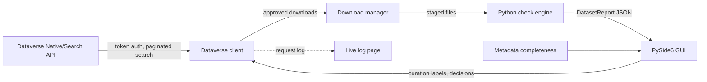

# Architecture

Dataverse Docent is a single PySide6 desktop process: the Dataverse API feeds approved downloads, the downloads feed a Python check engine, and the engine's report plus metadata completeness feed the GUI and a live request log. This page explains where the boundaries sit, what runs where, and the trade-offs behind those choices. It is background for changing the app, not a sequence of tasks.

## One process, strict boundaries

The app keeps one process so the views can share state cheaply, but it separates the work that is slow or failure-prone from the work that draws pixels. Network and engine work runs on parented `QThread` workers; the GUI thread only renders. The engine never touches the network, and `curation/` and `engine/` never import `ui/` or PySide6 — a rule enforced by import-linter rather than by review.



The diagram is the dependency direction, not a call graph. The client owns Dataverse, the download manager owns bytes on disk, the engine owns judgements about local files, and the GUI owns presentation. A change that crosses one of these lines is a design decision, not a refactor.

## The layers and why they are separate

| Layer | Owns | Why it is its own layer |
| --- | --- | --- |
| Dataverse client (`curation/client/`) | Token auth, total-driven paginated Search, pooled inventory enrichment, metadata, file inventory, downloads, versions, timestamps, notifications, curation labels | The only layer that knows API shapes, retries and expected refusals. Keeping it alone means the engine stays headless and testable. |
| Download manager (`curation/download_manager.py`) | Size quotes, the approval gate, skip-if-staged, streaming, originals, verification, staging | Moves bytes and makes a promise about what is on disk. The engine consumes that promise without knowing how it was kept. |
| Check engine (`engine/`) | Per-format checks, registry-driven dispatch, `DatasetReport`, badge taxonomy, scan caps | Pure functions of local files. The same code runs in the GUI and in headless mode. |
| Metadata completeness (`curation/metadata_check.py`, `curation/review_rules.py`) | Versioned rulesets, field and text rules, response templates | Curation judgement about description, not file bytes; shares the report vocabulary without being a file check. |
| Local state (`curation/storage.py`, `curation/dashboard_cache.py`) | SQLite state and JSON caches | A disposable, rebuildable view of remote state, so a cold start can paint before the network answers. |
| GUI (`ui/`) | Dashboard, dataset detail, settings, review configuration, log, the kit and the theme | The only layer allowed to paint. It renders report structures without knowing individual checks. |

The engine's purity buys the headless entry point: `main.py --headless` exercises the same report contract without a window. It also buys a hard architectural contract — because the engine cannot import the view layer, a check can never acquire a hidden dependency on a widget or a screen.

## Threading: the GUI thread never blocks

Long work is moved off the GUI thread rather than made interruptible there. Workers are parented to their views and chain `deleteLater` on completion. When a detail view is discarded while its workers are still live, the main window adopts them; a live `QThread` is never destroyed, because Qt aborts the process if one is. Registration and interruption checks live in `ui/workers.py`, with hooks on `aboutToQuit` and at exit.

A dataset runs one check at a time, and each result is persisted as a `DatasetReport`, so a crash during a long review loses nothing that cannot be recomputed. The Log page polls the in-memory application log on an 800 ms timer, gated to page visibility, with a 200 ms search debounce. The log itself is a 2,000-line ring with token redaction; it is a diagnostic surface, never a store of secrets.

## How a review moves through the system

A dashboard refresh pages the Search API at `per_page=1000`, driven by the first response's `total_count`, deduplicates by persistent ID, and enriches drafts first with a small pooled batch of version fetches. That pass writes the cache and the queue. The first paint comes from the cache; a background diff reports what is new, updated or removed. Very large collections are painted through a bounded row window so the filter and sort stay responsive while the visible set is capped.

Opening a dataset schedules a metadata load: citation blocks, inventory, curation state, version comparison and timestamps arrive on a worker, and the detail page fills in as they land. Download All quotes the transfer first, using original size for tabular files, and waits for approval. Once approved, the bundle streams to a partial file and is renamed atomically; originals are fetched and `.tab` siblings removed for an originals-only deposit; `verify()` returns `(ok, problems, warnings)` rather than a single pass/fail, because a checksum mismatch and a recoverable warning are different curator facts. Both streaming loops poll a cancellation flag so the detail page's Cancel is real.

Checks then dispatch per file and at dataset level, writing reports under the staged dataset's workspace folder. The curator's attention lands on the main column — metadata completeness, dataset checks, file checks, version history — and on a sidebar that holds the response and the curation label. A verdict and per-finding dispositions live alongside the report, and the label push travels back through the client to Dataverse. The workflow rail only navigates between these sections; it deliberately never starts a download or an export.

## Local state is a cache, not the source of truth

`workspace/state.db` holds datasets, files, check results, the append-only curation timeline, per-finding dispositions, sensitivity reviews and follow-ups. Dispositions are keyed by a stable hash of check ID, path and message, so a re-run that reproduces a finding re-attaches the curator's decision instead of creating a new unresolved row.

Alongside it, JSON caches hold summed sizes, per-instance label sets, the last dashboard crawl for instant paint and change-only refresh, and per-table column layouts. Layout entries are versioned; an entry for a different column shape or a newer schema is ignored rather than half-applied.

Two files are user-editable and therefore follow a location policy rather than living in the workspace: `config.json` and `requirements_profiles.json`. Installed builds keep them under `%APPDATA%\Dataverse Docent\`, where an update or uninstall cannot reach them; portable builds keep them beside the executable; development runs use the working directory. One resolver, `config.resolve_user_file`, owns that rule, with a one-time copy from the old location. The portable package is recognised by a marker at its root, because it shares the `current/` and `Update.exe` layout with an installed copy.

## UI layering: palette → role → component

Every pixel comes from one place, and there are exactly three layers. A view composes them; it never paints.

The palette in `ui/theme.py` says what a colour is — `PRIMARY`, `SURFACE_CONTAINER_LOW`, `ERROR` — with no meaning attached. The role layer says what a colour is for — `ACCENT_PRIMARY`, `SURFACE_CARD`, `TEXT_DANGER` — as a mapping over the palette, one table per theme, so a theme swap is a table edit. The kit in `ui/widgets.py` builds what the user touches: `make_action_button()`, `make_badge()`, `make_list()`.

Only `ui/theme.py` and `ui/widgets.py` may name a palette entry. A view names a role, the kit builds the component, and the theme owns the rules. This is checked, not reviewed: `ui/tests/test_theme_conformance.py` fails the build when a view paints for itself, names a raw colour, builds a raw input widget or writes a button sheet by hand. The guards parse source with `ast`, so they are cheap, exact and need no window.

The role names are stable; what they resolve to is not. `ui/theme.py` holds one table per theme — `LIGHT_ROLE_TABLE` and `DARK_ROLE_TABLE` over the same 94 role names — plus a resolver and a switch. The light table is what the app paints today; dark mode is not shipped. The role groups give an idea of the vocabulary:

| Group | Purpose |
| --- | --- |
| Text | Copy on a known surface; each role names the surface it sits on, which makes the pairing checkable. |
| Surface | The plane a component sits on — page, card, header band, disabled face. |
| Border | An edge that separates, an edge that carries meaning, an edge of an unusable control. |
| Accent | The brand fill and its states; a component asks for "the accent", not for blue. |
| State | How an error, a pass and a caution look; text and graphic roles are separate because their contrast floors differ. |

Legibility is data too. `theme.CONTRAST_PAIRS` and `theme.BADGE_CONTRAST_PAIRS` list every painted foreground/background pair with its floor, and `ui/tests/test_contrast.py` reads that table:

| Kind | Floor | Why |
| --- | --- | --- |
| text | 4.5:1 | WCAG 2.1 AA for normal-size text. |
| graphic | 3:1 | WCAG 2.1 AA for icons and other non-text marks. |
| disabled | 3:1 | Disabled controls are exempt from WCAG 1.4.3; the app still holds them to 3:1 so an unusable control reads as present. |

That table caught three real defects: a disabled primary button at 2.35:1, muted text at 2.54:1 and a green badge fill at 3.30:1. Each now clears its floor. The same single-source idea shapes the button system — `theme.button_qss(kind)` generates both the app-level rule and the widget-level copy, so the two cannot drift. Labels wear object-name tokens, and a label whose text changes at runtime changes its token and re-polishes rather than painting itself.

The deeper rationale, including the Qt behaviours that forced these rules, is in [UI conventions](ui-conventions.md).

## One table, one layout owner

Every table and tree is built from `ui/widgets.py` and persists its layout through one `TableLayout` controller per header. `AppTable`, `AppTree` and `AppTreeWidget` share the header chrome and the same user-gesture signal; a view that needs a different table subclasses one of them.

The controller owns the construction snapshot, restore, persistence and reset, so no view repeats the wiring. The central rule is that only user gestures are persisted:

```python
self._layout = TableLayout(workspace, "dataset_files", tree.header(), view=tree)
self._layout.restore()  # the saved layout wins over the content fit

with self._layout.suppressed():  # the app's own change: not persisted
    tree.fit_columns_to_contents(floors={0: 260})

self._layout.reset()  # clears the saved entry, restores the snapshot
```

Programmatic resizes run inside `suppressed()` because a content fit, a viewport refit or a state restore must never overwrite a width the user chose. Four copies of wiring `sectionResized` straight to a save are how the file manifest once lost its widths on every refresh. The kit reports a gesture only when the user could have caused it, since Qt reports layout-owned and stretched sections the same way it reports a drag.

Geometry is part of the contract. The queue has no horizontal scrollbar, so its visible widths must add up to the viewport exactly; the fit shaves the difference off the widest sections. The queue uses the table's own header as its column bar — an older split header needed two-way size and order sync and produced clipped columns and an off-centre label. A table flush inside a card paints square end caps and transparent scrollbar lanes, because Qt never clips a child to a parent's border radius and a filled lane paints over the card's rounded corner. All text sizes come from the theme's `FONT_*` constants and object-name tokens; a raw `font-size: Npx` outside the theme fails the type-scale test.

## Reports and extensibility

The engine and the GUI communicate through `DatasetReport` JSON, implemented in `engine/report.py` and specified in the [report contract](../reference/report-contract.md). The GUI renders that structure directly, without knowing individual checks; headless mode exercises the same contract. A format check is a new module in `engine/checks/` implementing `Check`, registered in the registry. The Auto-Checks card and `list_planned_checks()` pick it up automatically, and missing optional libraries surface as "Missing …" rather than errors.

Scope is now declared, not inferred: every check states whether its findings are about the dataset or a file, the registry refuses a class that omits the declaration, and routing follows it. Extensions only say which files a check reads, so a cross-file check can still report once for the dataset. All 24 registered checks declare a scope. Human-readable names come from one `TITLES` registry, so a check is never shown to a curator by its raw ID. See the [checks reference](../reference/checks.md) for what each check examines.

## Startup and first paint

The window paints its shell before the cached dashboard, local state reads or any network call. `main.py` shows the window, processes the first frame, paints it synchronously and reveals it, then starts the background load. Until that reveal the window is cloaked out of DWM composition, so neither an empty client nor a native title bar can flash on screen. Settings, About, Review configuration and Log are built on first navigation, keeping the initial widget tree small. Pointing `DOCENT_STARTUP_LOG` at a file records one row per phase; the probe is inert when the variable is unset.

## Packaging and deployment

There is one build artefact. `poe build` produces `dist/DataverseDocent/DataverseDocent.exe` in onedir form, with safe trims only — every format library stays in. The folder launches in about two seconds because nothing is re-extracted and re-scanned on each run; the earlier onefile layout paid that cost on every launch. `poe pack` turns the same folder into a Velopack release: a per-user `Setup.exe`, a portable zip, a `nupkg` and the update feed.

Keeping one build is a deliberate simplification. The portable zip is the small download the old `lite` variant existed to provide, so a second build bought cost without buying choice. Every format library ships in both the installer and the zip, and a frozen run that lacks a library names a reinstall rather than a second download.

Install identity is fixed in `tools/build/check_pack.py`: the pack ID names the install directory and the update feed, so changing it would orphan existing installs instead of updating them. Updates are deltas. The .NET SDK is required only to run the packer, never by the shipped app. Distributed Windows builds are signed through a managed service, with the first releases unsigned and checksums published. No R runtime ships: R was needed only during the port for parity verification. macOS is deferred, because an unnotarised app is blocked by Gatekeeper and notarisation needs a paid developer program.

## Decision log

A condensed record of the decisions that shaped the current shape. The full history lives in the repository's decision records and beads.

| Date | Decision |
| --- | --- |
| 2026-08-17 | PySide6 single-process desktop; API-token auth; Python port over portable R (~400 MB). |
| 2026-08-21/25 | CLI draft crawl and IN_REVIEW locks; paginated Search fallback; streaming download; connection-reset retry; metadata completeness as a first-class feature; lazy imports. |
| 2026-09-08/15 | Detail main + sticky sidebar; settings/about as stack panes; log strip became the Log page; problems-vs-warnings verification; originals-only tabular deposits; skip-if-staged; QThread adoption; dashboard cache-first paint. |
| 2026-09-11/23 | `ui/widgets.py` kit as single source of truth (a QML UI was rejected); audit batches for dispatch, missing-lib guards, atomic staging, retries, caps and taxonomy. |
| 2026-09-25 → 10-02 | Theme tokens single-sourced; keyboard parity and plain-language errors; colour-not-outline focus; Copy diagnostics that never include the token. |
| 2026-10-06 | Dataverse Docent rebrand; probe suites promoted to permanent tests and CI. |
| 2026-10-29 | The crawler was removed after its upstream restructure broke the CLI contract. Discovery became total-driven Search at `per_page=1000` plus in-process pooled inventory enrichment, available to every user including frozen builds; a painted-row window was added for very large collections. |
| 2026-11-04 | One layout controller per table header, persisting user gestures only; the queue's split header demoted to an opt-in fallback; one reset-columns affordance; one type scale; versioned layout entries. |
| 2026-11-06 | Beads became the planner: issues live in a local Dolt database, `bd ready` is the queue, and docs/proposals mirror rather than lead. |
| 2026-11-07 | Card header contract: titles and tools on separate rows; one decimal size helper; measured first-load geometry. |
| 2026-11-12 | Metadata check restyled to the Auto-Checks idiom; human-readable check names from one registry; expected API refusals classified rather than reported as bugs. |
| 2026-11-13 | Entry-correctness rules (`looks_correct`) added with fail-closed semantics; review configuration gained a Check picker and an entry-checks panel. |
| 2026-11-16 | Velopack replaced the earlier installer plan; user-editable files moved to `%APPDATA%`; the curation core was consolidated under `curation/`. |
| 2026-11-16 | One name and one build: the app, the artefact, the installer and the distribution all say Dataverse Docent; the two-variant build was removed. |
| 2026-11-17 | The dataset detail module was split into a facade over ten section modules sharing one typed contract; the queue painting window and enrichment cap were measured and confirmed. |
| 2026-11-19 | Every check now declares its scope; the Python floor was made 3.11 everywhere; dependency floors were aligned with what ships. |
| 2026-11-20 | All application code moved to full strict type checking with only tests relaxed; documentation moved to Zensical and GitHub Pages, leaving the old HTML tree frozen as a reference. |

The proposal snapshots that produced several of these decisions are kept as historical design records, described in [Design records](design-records/index.md).
